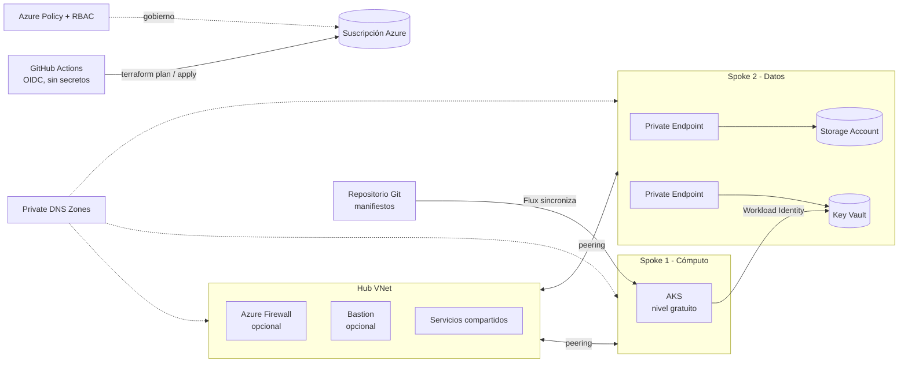

# Azure Landing Zone Lab

Landing zone pequeña pero realista en Azure, definida íntegramente como código con Terraform. Diseñada para ser barata, efímera (`make up` / `make down`) y para demostrar prácticas de un puesto de Cloud Engineer / SysAdmin, alineadas con el temario de AZ-104.

> **Estado: en construcción.** Fase 0 completada (entorno, convenciones y calidad de código). Ver [hoja de ruta](#hoja-de-ruta).

## Qué demuestra

- Red hub-spoke con peering, NSGs y tablas de rutas
- Private Endpoints y Private DNS Zones (Storage y Key Vault sin acceso público)
- Azure Policy para gobierno (etiquetas, ubicaciones, sin IPs públicas ni acceso público)
- RBAC con mínimo privilegio sobre grupos de Entra ID
- AKS con Entra ID, Azure RBAC y Workload Identity, gestionado con GitOps (Flux)
- CI/CD con GitHub Actions y OIDC (sin secretos guardados)
- Control de costes (presupuesto con alertas) y monitorización acotada

## Arquitectura objetivo



## Principios de diseño

- **Coste mínimo:** los recursos que cobran por estar encendidos (Firewall, Bastion, VM de laboratorio) van detrás de variables `enable_*`, desactivadas por defecto.
- **Efímero y reproducible:** todo se levanta y se destruye con un comando.
- **Mínimo privilegio:** la identidad (grupos y OIDC) se crea en un bootstrap aparte, para que el pipeline no pueda escalar privilegios.
- **Decisiones documentadas:** ver [`docs/adr/`](docs/adr/).

## Estructura del repositorio

| Ruta | Contenido |
|---|---|
| `bootstrap/` | Estado remoto de Terraform e identidad (se ejecuta una vez, en local) |
| `modules/` | Módulos reutilizables: red, DNS privado, datos, AKS, gobierno, RBAC, monitorización, costes |
| `environments/lab/` | Entorno que compone los módulos |
| `gitops/` | Manifiestos que sincroniza Flux |
| `local/kind/` | Clúster local para practicar GitOps sin gastar crédito |
| `.github/workflows/` | Pipelines de CI/CD |
| `docs/` | ADRs, convenciones y documentación del entorno |

## Hoja de ruta

- [x] **Fase 0:** entorno local, convenciones, ADRs, pre-commit, tflint, checkov
- [ ] **Fase 1:** CI temprano (fmt, validate, tflint, checkov en cada PR)
- [ ] **Fase 2:** bootstrap (estado remoto, grupos Entra ID, OIDC)
- [ ] **Fase 3:** red hub-spoke
- [ ] **Fase 4:** datos con Private Endpoints y Private DNS
- [ ] **Fase 5:** Azure Policy y RBAC
- [ ] **Fase 6:** monitorización y costes
- [ ] **Fase 7:** AKS
- [ ] **Fase 8:** GitOps con Flux
- [ ] **Fase 9:** CD completo (plan en PR, apply con aprobación)
- [ ] **Fase 10:** demo, capturas y estimación de costes

## Documentación

- [Convención de nombres y etiquetas](docs/naming-and-tagging.md)
- [Preparación del entorno local](docs/setup-entorno-local.md)
- [Decisiones de arquitectura (ADRs)](docs/adr/)

## Cómo trabajar en el repositorio

```bash
make help    # comandos disponibles
make check   # ejecuta los hooks de pre-commit
```

`main` está protegida: todos los cambios entran por Pull Request.

## Licencia

MIT
